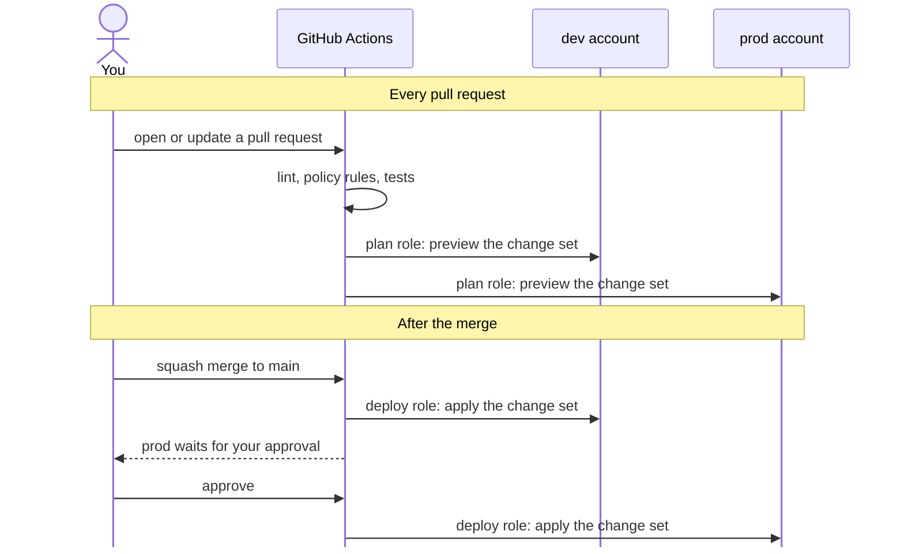
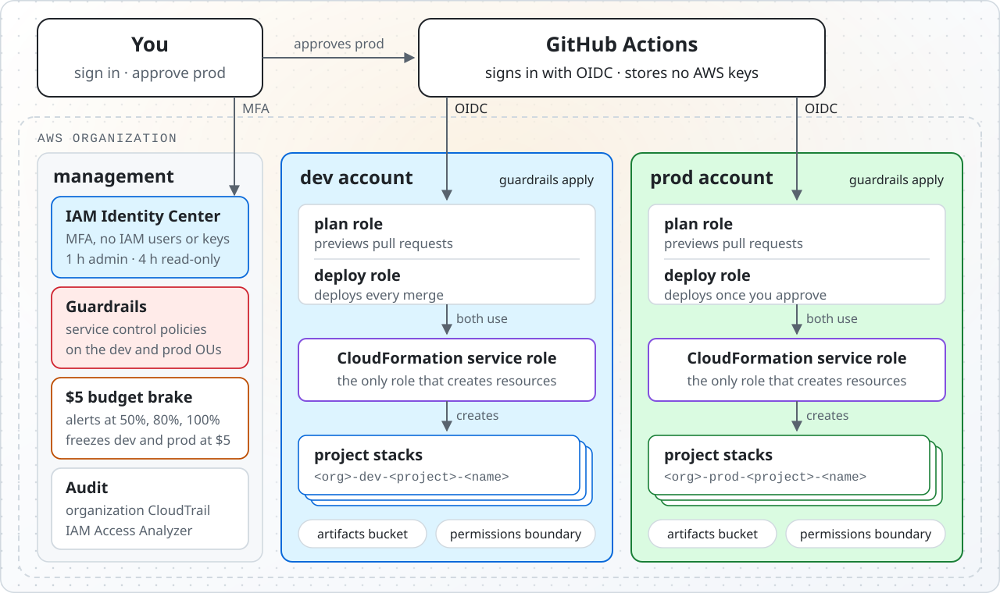

<p align="center">
  <picture>
    <source media="(prefers-color-scheme: dark)" srcset="docs/assets/banner-dark.svg">
    <source media="(prefers-color-scheme: light)" srcset="docs/assets/banner-light.svg">
    
  </picture>
</p>

<h3 align="center">One repository. Many AWS projects. Every change through a pull request.</h3>

<p align="center">
  <a href="https://github.com/kazinayeem-eng/aws-data-platform/actions/workflows/deploy-sample.yml"></a>
  
  
  
  
  
  
</p>

<p align="center">
  <a href="#projects"><b>Projects</b></a> ·
  <a href="#how-a-change-reaches-aws"><b>How a change ships</b></a> ·
  <a href="#the-platform"><b>The platform</b></a> ·
  <a href="#add-a-project"><b>Add a project</b></a> ·
  <a href="#rules"><b>Rules</b></a> ·
  <a href="#docs"><b>Docs</b></a>
</p>

This repository holds the AWS infrastructure for a set of data and AI projects. Each project lives in its own folder, with its own CloudFormation stacks and its own deploy workflow. A pull request previews exactly what it would change in dev and prod. A merge deploys to dev, then to prod after one approval. No AWS keys are stored anywhere.

## At a glance

<table>
  <tr>
    <td width="50%" valign="top">🔐&nbsp;<b>No keys to leak</b><br>GitHub signs in with OIDC and people sign in with MFA, so there is nothing long-lived to steal.</td>
    <td width="50%" valign="top">👀&nbsp;<b>See it before it ships</b><br>A pull request shows the change set CloudFormation would run in dev and in prod, for each project it touches.</td>
  </tr>
  <tr>
    <td width="50%" valign="top">✋&nbsp;<b>You approve prod</b><br>A merge deploys to dev straight away. Prod waits until you approve.</td>
    <td width="50%" valign="top">🧩&nbsp;<b>Projects stay apart</b><br>Each project has its own folder, stacks and workflow, so a change to one never redeploys another.</td>
  </tr>
  <tr>
    <td width="50%" valign="top">🛡️&nbsp;<b>Guardrails at every layer</b><br>Service control policies on the accounts, a permissions boundary on every role a stack creates, and policy rules on every template.</td>
    <td width="50%" valign="top">💸&nbsp;<b>A $5 brake</b><br>Budget alerts at 50%, 80% and 100%. At $5 of actual spend, dev and prod freeze.</td>
  </tr>
</table>

## Projects

Each project lives in `projects/<project>/`, deploys through its own workflow, and never touches another project's stacks.

<!-- To add a project: add a row to this table, then a "### <Project name>" section below, like the APA one. -->

| Project | What it does |
|:--|:--|
| [**Agentic Pipeline Assurance**](#agentic-pipeline-assurance-apa) | AI agents find, fix and prove a broken nightly data load, and wait for a person before anything touches live data |

> [!TIP]
> `projects/sample` is the starter project: one hardened S3 bucket per environment. It proves the pipeline works end to end, and it is the pattern to follow when you [add a project](#add-a-project).

### Agentic Pipeline Assurance (APA)

<p align="center">
  <picture>
    <source media="(prefers-color-scheme: dark)" srcset="docs/assets/apa-card-dark.svg">
    <source media="(prefers-color-scheme: light)" srcset="docs/assets/apa-card-light.svg">
    
  </picture>
</p>

At 02:14 the nightly customer load fails: the upstream file has renamed `cust_status` to `customer_status`, and the dashboard must be correct by 08:00. APA is a team of AI agents that handles this kind of failure the way a careful on-call engineer would, and stops for a person before changing anything live.

| Agent | Its job |
|:--|:--|
| **Orchestrator** | Briefs each specialist and checks every handoff before passing the work on |
| **Detector** | Finds what failed and where, from the job logs and the table schema |
| **Diagnoser** | Explains why, with evidence: it searches the runbook and the data contract (RAG) and recalls lessons from past incidents (memory) |
| **Fixer** | Builds the fix in a test copy of the table. It cannot write to the live table: a hook, the tool server and the database role each block it |
| **Verifier** | Runs four checks on the test copy, and runs them again on live after the swap |

You get one email with the evidence, and nothing changes in live until you approve it. Then the test copy is swapped in and the dashboard is republished. The approval link works once, and if nobody approves within 30 minutes, the live table stays untouched.

<p>
  
  
  
  
  
  
  
</p>

**Where it runs.** While it is being built (Phases 1 to 7), the agents run on a Mac and use real AWS services: Step Functions, Bedrock, S3 and DynamoDB. Phase 8 deploys the same code as Lambda functions for a one-day cloud demo, then switches it off. The whole build stays under the platform's $5 monthly budget.

<details>
<summary><b>The build plan: nine phases, about 20 weeks at 2 to 3 hours a week</b></summary>
<br>

Each phase ends with a gate: a short checklist that must pass before the next phase starts.

| Phase | What it adds | Time |
|:--:|:--|:--:|
| 0 | Foundations: tools, repo, roles, three spikes and a hello-world deploy | 1 week |
| 1 | The pipeline, no agents: make the nightly load fail properly | 2 weeks |
| 2 | The first agent: the Detector, MCP tools and the agent loop | 2 weeks |
| 3 | The Diagnoser: RAG, memory and grounding | 2 weeks |
| 4 | The Fixer: sandbox, guardrails, policy, identity and approval | 4 weeks |
| 5 | The Verifier and the eval set: proof instead of "it worked" | 2 weeks |
| 6 | The Orchestrator: four specialists become a team | 2 weeks |
| 7 | Observability, protocols and a comparison of two models | 3 weeks |
| 8 | Ship it: the cloud demo, the portfolio, and switching off | 2 weeks |

</details>

## How a change reaches AWS



1. **Branch and pull request.** `main` is protected, so every change starts on a branch and lands as one squash merge.
2. **Checks.** `cfn-lint` and the Guard rules check every template, `actionlint` and `zizmor` check the workflows, and `shellcheck` and `tests/pipeline-test.sh` check the scripts.
3. **Preview.** For each project the pull request touches, the plan role asks CloudFormation for a change set in dev and in prod, so you see exactly what would be added, changed or replaced. A change under `scripts/`, `bootstrap/` or `.github/` previews every project. A Markdown-only change previews nothing.
4. **Deploy.** The merge runs that project's own workflow. It deploys to dev, then waits for you to approve the `prod` environment before deploying there.

## The platform

Three accounts, two ways in, and no stored keys: you sign in through IAM Identity Center with MFA, and GitHub signs in with OIDC.

<p align="center">
  <picture>
    <source media="(prefers-color-scheme: dark)" srcset="docs/assets/platform-dark.svg">
    <source media="(prefers-color-scheme: light)" srcset="docs/assets/platform-light.svg">
    
  </picture>
</p>

| Layer | What it does |
|:--|:--|
| **Accounts** | Management, dev and prod in one AWS Organization. Dev and prod each sit in their own organizational unit, so a mistake in dev has no route into prod. [D1](docs/decisions.md#d1-three-aws-accounts-in-one-organization) |
| **People** | IAM Identity Center with MFA. Sessions last 1 hour (admin) or 4 hours (read-only). No IAM users and no access keys. [D2](docs/decisions.md#d2-people-sign-in-with-iam-identity-center) |
| **Guardrails** | Service control policies deny the root user, leaving the organization, tampering with security controls, and unapproved regions. They limit even administrators. [`guardrails.yml`](bootstrap/management/guardrails.yml) |
| **Pipeline roles** | In dev and prod: a plan role for pull requests (preview only), a deploy role reachable only through a GitHub Environment, and a CloudFormation service role that alone creates resources. Each GitHub role trusts one exact token subject, pinned to this repository's numeric IDs. [`pipeline-identity.yml`](bootstrap/workload/pipeline-identity.yml) · [D3](docs/decisions.md#d3-github-signs-in-with-oidc-one-role-per-purpose) |
| **Permissions boundary** | The service role can create a role only if it is named `<org>-<env>-*` and carries the boundary `<org>-workload-boundary-<env>`, which denies any change to identities, the organization or the account. [D6](docs/decisions.md#d6-roles-created-by-stacks-must-carry-a-permissions-boundary) |
| **Policy rules** | Every template must pass the cfn-guard rules in `guard/`. Today they require every S3 bucket to be encrypted, private, and kept when a change replaces it. [`guard/`](guard/) · [D8](docs/decisions.md#d8-policy-rules-with-cfn-guard-not-checkov) |
| **Budget brake** | A $5 monthly budget alerts at 50%, 80% and 100% of actual spend, and at 100% of forecast spend. At $5 of actual spend, the brake freezes dev and prod. [D10](docs/decisions.md#d10-a-5-monthly-cost-ceiling-with-an-automatic-brake) |

Every choice above, with the reason for it and when to revisit it, is in [`docs/decisions.md`](docs/decisions.md). The gaps left open on purpose are in [`docs/accepted-risks.md`](docs/accepted-risks.md).

## Add a project

1. **Pick a name.** Use 2 to 20 lower-case letters, digits or hyphens, starting with a letter.
2. **Add a stack.** Create `projects/<project>/stacks/00-<name>/` with `template.yml`, `dev.json` and `prod.json`.
3. **Add its workflow.** Copy the sample's and swap the name:
   ```sh
   sed 's/sample/<project>/g' .github/workflows/deploy-sample.yml \
     > .github/workflows/deploy-<project>.yml
   ```
4. **Check it.**
   ```sh
   uv run cfn-lint projects/<project>/stacks/*/template.yml
   cfn-guard validate --rules guard/ --data projects/<project>/stacks/00-<name>/template.yml
   ```
5. **Open a pull request.** `Preview dev` and `Preview prod` show what will be created.
6. **Merge.** The new workflow deploys dev, then waits for your approval before prod.

> [!NOTE]
> If the project needs a resource type the service role cannot create yet, widen `bootstrap/workload/pipeline-identity.yml` in its own pull request first, then redeploy it by hand in dev and prod.

### Names

A stack is named `<org>-<env>-<project>-<name>`, where `<name>` is the stack folder without its number: `projects/sample/stacks/00-bucket` becomes `acme-dev-sample-bucket`.

Name every resource a project creates `<org>-<env>-<project>-...` too. The service role can only create resources whose names start with `<org>-<env>-`, so that part is required, not just tidy. IAM roles must also carry the permissions boundary `<org>-workload-boundary-<env>`.

## Remove a project

1. Empty its buckets, then delete its stacks in dev and prod, in the console or with an admin profile. Deleting a stack removes everything in it, buckets included. A stack whose bucket is not empty stops at `DELETE_FAILED`: empty the bucket and delete again.
2. In a pull request, delete `projects/<project>/` and `.github/workflows/deploy-<project>.yml`.

The full steps are in [the runbook](docs/runbooks.md#removing-a-project).

## Rules

> [!IMPORTANT]
> - `main` is protected. Every change is a branch, a pull request and a squash merge.
> - No keys, passwords or tokens in the repo. The pipeline signs in with OIDC.
> - Never widen a role to `*`.
> - Run `bash tests/pipeline-test.sh` after changing anything in `scripts/`.
> - Deleting a stack folder never deletes the stack in AWS. That is always a deliberate, manual step.
> - If spend reaches the monthly budget, the budget brake freezes dev and prod until you release it. See [the runbook](docs/runbooks.md#the-budget-brake-fired).

## Repository layout

```text
.
├── projects/
│   ├── sample/                 the starter: one hardened S3 bucket
│   └── <project>/
│       ├── stacks/<NN-name>/   template.yml, dev.json, prod.json
│       └── …                   code, tests and docs
├── .github/workflows/
│   ├── pr-validate.yml         checks and previews on every pull request
│   ├── deploy-project.yml      shared deploy steps
│   └── deploy-<project>.yml    one deploy workflow per project
├── scripts/                    the pipeline scripts
├── tests/pipeline-test.sh      tests for those scripts
├── guard/                      policy rules for every template
├── bootstrap/                  guardrails, budget brake, pipeline roles
├── docs/                       decisions, risks, runbooks, README images
└── pyproject.toml, uv.lock     pinned Python tools (uv run …)
```

Stacks deploy in folder order, so `00-foundation` goes before `01-pipeline`. Everything in `bootstrap/` is deployed by hand.

## Run the checks locally

The same checks a pull request runs:

```sh
# Install the pinned cfn-lint and zizmor
uv sync --locked

# Templates: lint them, then check them against the policy rules
uv run cfn-lint bootstrap/*/*.yml projects/*/stacks/*/template.yml
cfn-guard validate --rules guard/ --data <template.yml>

# Workflows
actionlint
uv run zizmor --offline --min-severity medium .github/workflows/

# Pipeline scripts
shellcheck scripts/*.sh tests/*.sh
bash tests/pipeline-test.sh
```

`cfn-guard`, `actionlint` and `shellcheck` are separate installs. CI downloads pinned, checksum-verified copies.

## Docs

| Document | Read it when |
|:--|:--|
| [Decisions](docs/decisions.md) | You want to know why the platform works the way it does, and when to revisit each choice |
| [Accepted risks](docs/accepted-risks.md) | You are about to add a collaborator, real data, or more spend |
| [Runbooks](docs/runbooks.md) | A deploy fails, the budget brake fires, or it is time for regular upkeep |

<br>

<p align="center"><sub>Built and run by one person, on a budget of $5 a month · <a href="#top">Back to top ↑</a></sub></p>
